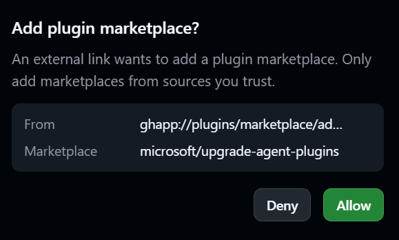

# GitHub Copilot upgrade

GitHub Copilot upgrade is an AI-powered agent that helps you upgrade applications to newer versions of languages, frameworks, and runtimes. It assesses your application, creates an upgrade plan, applies code changes, and validates the results through an interactive upgrade workflow.

## Get started

GitHub Copilot upgrade is available from both the GitHub Copilot app and GitHub Copilot CLI.

### GitHub Copilot app

Click this [**link**](https://github.com/copilot/app/launch?entry_point=upgrade_agent_plugins_readme&open=ghapp%3A%2F%2Fplugins%2Fmarketplace%2Fadd%3Fsource%3Dmicrosoft%2Fupgrade-agent-plugins) to automatically open the Settings > Plugins window in the GitHub Copilot app.

In the **Add plugin marketplace** dialog, select **Allow**.



Go to the **Customize** view and search for `upgrade-agent`. Under the **All marketplaces** dropdown, select the `upgrade-agent-plugins`, and select **Install** on the `upgrade-agent` plugin.

_Note: Prior to v1.0.3 of the GitHub Copilot app, you will need to restart the app after installing the plugin before you can use the GitHub Copilot upgrade agent._

Select the ```Upgrade``` agent from the Agent Picker:

Prompt the agent: 

```
upgrade my project to .NET 11
```

### GitHub Copilot CLI

Add the marketplace:

```javascript
/plugin marketplace add microsoft/upgrade-agent-plugins
```

Install the GitHub Copilot upgrade plugin:
```javascript
/plugin install upgrade-agent@upgrade-agent-plugins
```
Select the agent:

```/agent``` to select  ```Upgrade ```

Prompt the agent: 

```
upgrade my solution to .NET 10
```

### Copilot Coding Agent

A custom agent definition and setup steps are provided for use with [Copilot Cloud Agent](https://docs.github.com/en/copilot/concepts/agents/cloud-agent/about-cloud-agent) in GitHub. This allows Copilot to upgrade projects directly via pull requests.

See the [cloud-agent README](cloud-agent/README.md) for setup instructions.
